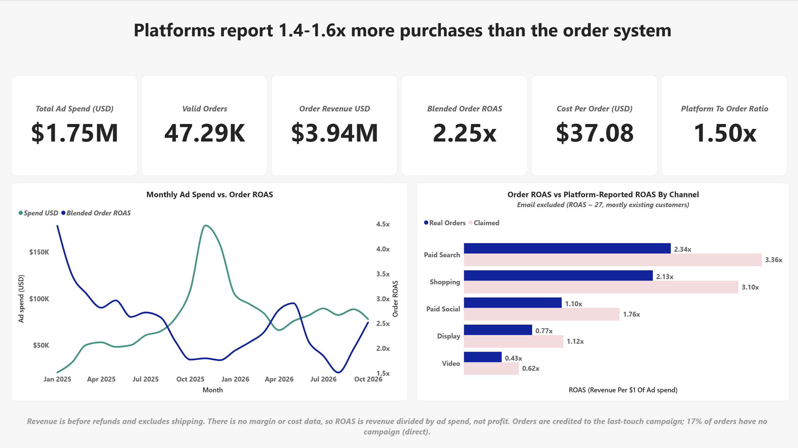
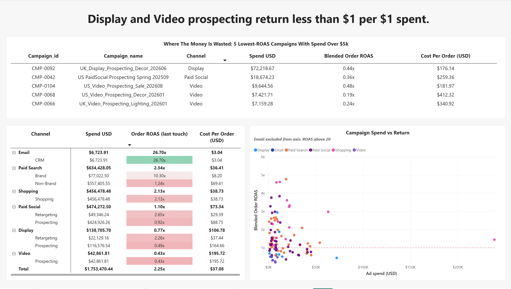
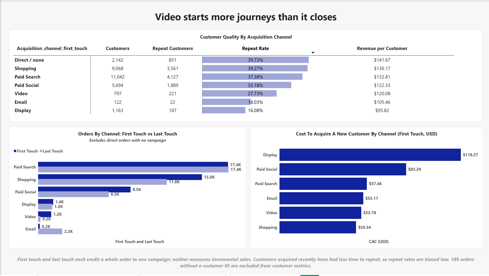
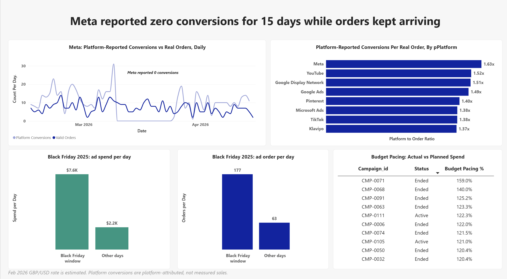

# Lumora Home: Marketing Performance & Acquisition Efficiency Review

A marketing analytics case study on 22 months of paid media, orders and CRM data for a UK/US home-furnishings retailer. The data is **synthetic** and was built to behave like real ad-platform and e-commerce exports, including the quality problems real exports have.

**Tools:** Python (pandas) · SQL (MySQL 8) · Power BI · Excel

**Status:** complete. Audit, cleaning, SQL, analysis, findings and a 4-page Power BI dashboard.

dashboard/

## The business problem

The CMO is planning the 2027 budget and Finance says marketing spend has grown faster than revenue. Each ad platform reports its own conversions, the business keeps its own order records, and the two have never been reconciled. The question: **where is the money working, where is it not, and can the platform numbers be trusted?**

The full brief, stakeholders and the 12 business questions are in [`docs/project_brief.md`](docs/project_brief.md).

## Key findings

* Platforms report **1.4–1.6× more purchases than the order system** on every platform, so platform CPA and ROAS are flattering.
* **Prospecting on Display, Video and Paid Social returns about $1 or less per $1 of ad spend** on last-touch. Video looks much better on first-touch (customer acquisition cost $54 vs $196 per last-touch order), so it needs a test, not a cut.
* **CMP-0092** (UK Display prospecting) took 4.1% of spend for an order ROAS of 0.44.
* **Meta reported zero conversions for 15 days** (10–24 Mar 2026) while 118 Meta-attributed orders arrived.
* Black Friday spend per day was 3.4× normal but orders per day only 2.8×, at an 11% average discount.

Full evidence, caveats and recommended tests: [`docs/findings.md`](docs/findings.md).

## Dashboard

A 4-page Power BI report built on the star-schema files in [`powerbi/`](powerbi/). Open the [PDF export](dashboard/Marketing_Analytics.pdf) to scroll through it.

| Page | What it answers |
| --- | --- |
| 1. Executive summary | How much was spent, what came back, and how far do platform numbers overstate results? |
| 2. Channel and campaign efficiency | Which channels, campaign types and campaigns earn their spend, and which do not? |
| 3. Attribution and customers | Who starts journeys and who closes them? What does a new customer cost, and are they worth it? |
| 4. Can we trust the data? | The Meta tracking outage, platform overcounting, Black Friday and budget pacing |





Design and measure notes are in [`docs/dashboard_brief.md`](docs/dashboard_brief.md).

## Data

| File | Rows | What it is |
| --- | --- | --- |
| `campaigns.csv` | 111 | Campaign master list (channel, platform, type, market, budget) |
| `ad_performance_daily.csv` | 73,628 | Daily platform data by campaign, ad group and device |
| `orders.csv` | 47,669 | Orders from the business's own system, with first and last touch campaign |
| `customers.csv` | 30,499 | CRM customer records |
| `fx_rates_monthly.csv` | 21 | Monthly GBP to USD rates |

Column definitions are in [`docs/data_dictionary.md`](docs/data_dictionary.md).

## What I did

1. **Audited** the raw files with a fixed set of checks and quantified every issue ([`00_data_audit.ipynb`](notebooks/00_data_audit.ipynb)).
2. **Cleaned** them with documented, reproducible decisions: every fix is counted, labelled Fix, Flag or Remove, and recorded with its assumption and risk ([`01_data_cleaning.ipynb`](notebooks/01_data_cleaning.ipynb), [`docs/data_quality_report.md`](docs/data_quality_report.md)).
3. **Validated** the result with automated checks: row reconciliation, uniqueness, allowed values, date ranges, joins and FX coverage.
4. **Queried** the clean data in SQL to build channel KPIs ([`sql/`](sql/)).
5. **Analysed** performance in USD, reconciling platform-reported results with real orders, attribution, CAC, pacing and tracking outages ([`02_analysis.ipynb`](notebooks/02_analysis.ipynb), [`sql/03_analysis.sql`](sql/03_analysis.sql)).
6. **Built a dashboard** in Power BI with a star-schema model and DAX measures, checked against the analysis tables in `outputs/`.
7. **Wrote up findings** with caveats and tests to run next ([`docs/findings.md`](docs/findings.md)).

## Data quality highlights

* **Two date formats in one column** (`2025-01-06` and `06/01/2025`). A date such as `07/03/2025` is ambiguous, so the format was settled using neighbouring rows in a date-ordered file, and each format was parsed separately.
* **Spend values about 100 times too large.** Whole-number spends far above their campaign's median produced cost per click of roughly 78 instead of 0.78. Corrected in a separate column, with the original kept.
* **Impossible rows.** Clicks above impressions (146 rows), campaign end dates before start dates (3) and customer signups after the data period ended (304) were flagged, not guessed.
* **Duplicates that distort totals.** 584 duplicate ad rows would have double-counted spend, 284 duplicate orders would have double-counted revenue, and 357 duplicate customers would have inflated new-customer counts.
* **Blanks that are information.** A blank last-touch campaign on an order means direct or unattributed, so it was kept, not deleted.
* **Currency.** UK data is in GBP and US data in USD, so the two are never added without conversion.

## Limitations

* The data is synthetic, so results describe the method, not a real company.
* Platform conversions and revenue are platform-attributed and overlap with each other; they are a claim, not a measurement of incremental sales.
* Revenue is before refunds and excludes shipping. There is no margin or cost data, so ROAS is revenue divided by ad spend, not profit.
* Last-touch and first-touch attribution each credit a whole order to one campaign; neither measures incrementality.
* The February 2026 GBP/USD rate is missing from the source and was estimated from neighbouring months.
* Several cleaning decisions are judgment calls; each is documented with its risk in the data quality report.

## Roadmap

- [x] Business case and data dictionary
- [x] Data audit
- [x] Data cleaning and validation
- [x] SQL setup and first channel KPIs
- [x] Currency conversion and platform-vs-orders reconciliation
- [x] Attribution, seasonality, device and budget pacing
- [x] Customer acquisition cost and customer quality
- [x] Power BI dashboard
- [x] Findings and recommendations

## Repository structure

```
data_raw/        original synthetic data (5 files, untouched)
data_clean/      cleaned data, quarantined rows, customer merge map, cleaning_log.csv
notebooks/       00_data_audit, 01_data_cleaning, 02_analysis (.ipynb)
sql/             01_setup_and_types.sql, 02_kpi_analysis.sql, 03_analysis.sql, results/
outputs/         analysis tables behind each finding (q1 … q12)
powerbi/         star-schema CSVs used by the dashboard
dashboard/       dashboard screenshots and PDF export
docs/            project_brief, data_dictionary, data_quality_report, findings, dashboard_brief
```

## How to reproduce

1. Install Python 3 with `pandas`, `numpy` and `jupyter`.
2. Run `notebooks/00_data_audit.ipynb`, then `notebooks/01_data_cleaning.ipynb` (Kernel, Restart and Run All). The second recreates everything in `data_clean/`.
3. Import the `data_clean/` CSVs into MySQL and run `sql/01_setup_and_types.sql`, then `sql/02_kpi_analysis.sql` and `sql/03_analysis.sql`.
4. Run `notebooks/02_analysis.ipynb` to regenerate `outputs/` and `powerbi/`.
5. To rebuild the dashboard, load the CSVs in `powerbi/` into Power BI and follow `docs/dashboard_brief.md`.

## Author

Blessing Ajibokun · [LinkedIn] · [Portfolio website]
